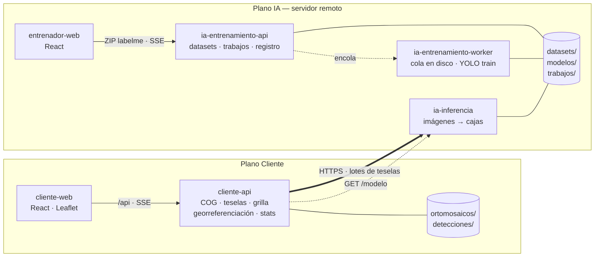
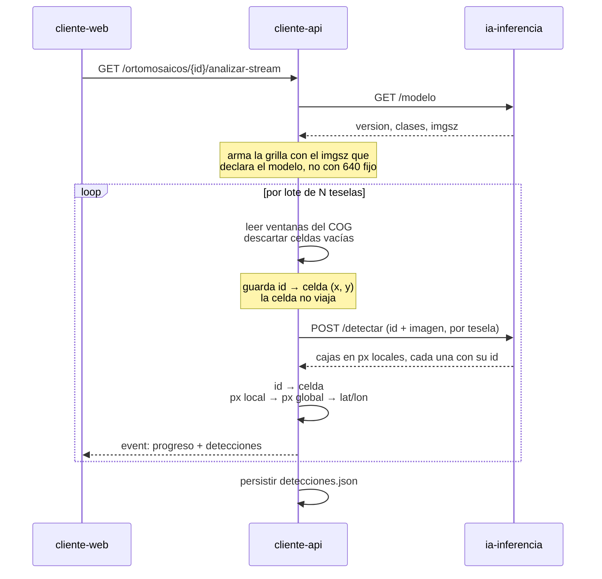
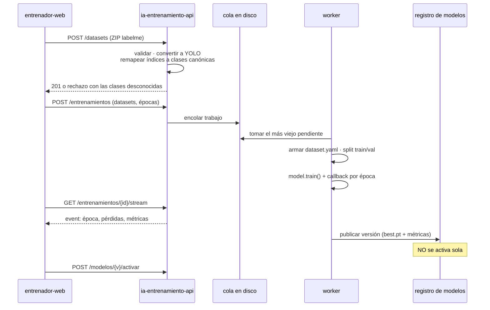

# Arquitectura — PTI 2026

Documento de diseño para pasar del MVP monolítico (`project/mvp/`) a tres planos
desplegables por separado. Describe el estado objetivo, no el actual.

## 1. Los tres planos

El sistema se parte en tres grupos de servicios que se despliegan y versionan
por separado. Les decimos *planos* y no "backoffices" porque uno de ellos no
tiene interfaz de usuario propia.

| Plano | Qué hace | Dónde vive |
|---|---|---|
| **IA** | Infiere sobre imágenes, entrena modelos nuevos, guarda el registro de versiones | Servidor remoto (el que tenga más CPU/GPU) |
| **Cliente** | Carga ortomosaicos, los muestra en el mapa, pide análisis y arma estadísticas | Donde esté el usuario final |
| **Entrenador** | Interfaz para subir aportes etiquetados y lanzar entrenamientos | Se sirve desde el plano IA |

### Por qué el plano Entrenador no tiene backend propio

El pedido original eran tres pares front+back. El "back" del entrenador sería
un intermediario entre el navegador y el servicio de entrenamiento, sin lógica
propia: los datasets tienen que estar en el disco del servidor que entrena, así
que un intermediario solo agregaría un salto de red y una copia de archivos
grandes. El plano Entrenador es entonces **solo una SPA** que habla directo con
`ia-entrenamiento-api`, servida por el mismo nginx del plano IA (una sola
instalación de TLS, cero CORS).

Si más adelante hace falta una capa propia —auth federada con el plano Cliente,
auditoría, varios entrenadores con permisos distintos— se agrega ahí un BFF sin
tocar el resto.

## 2. La decisión central: qué cruza la red

El ortomosaico de prueba pesa 1,3 GB. Mandarlo al servidor de IA en cada
análisis no es viable, y tampoco tiene sentido: el modelo nunca ve el raster
completo, ve celdas de 640 px.

Entonces **el plano IA no sabe nada de geografía**. Recibe imágenes y devuelve
cajas en píxeles locales. Todo lo geoespacial —conversión a COG, teselas XYZ
para Leaflet, la grilla de 640 px, la lectura por ventanas, el descarte de
celdas vacías y la traducción a lat/lon— queda en `cliente-api`, que es quien
tiene el raster y su `transform`.

Esto deja al servicio de IA stateless y reusable: mañana le pega otro cliente,
o un script, o un notebook, sin cambiarle nada.

**Costo en ancho de banda.** Un análisis completo del ortomosaico de prueba son
unas 2400 celdas (número visto en la práctica, ver el comentario de
`TAMANO_LOTE_MAX` en `predict.py`). A ~80 KB por tesela comprimida da del orden
de 150–200 MB de subida por análisis, contra 1,3 GB del TIFF; la respuesta es
JSON y es despreciable. El filtro de celdas oscuras o sin textura
(`leer_tile_filtrado`) baja ese número bastante porque esas teselas nunca
llegan a enviarse. Si el enlace no da, la salida es co-locar `ia-inferencia`
junto al plano Cliente y dejar cruzando la red **solo el plano de control**
(encolar entrenamientos, descargar la versión nueva del modelo), que son
kilobytes y un `.pt` de 6 MB.

## 3. Diagrama de componentes



La única flecha gruesa es la que cruza el límite de red en caliente. El resto
es control o tráfico local.

## 4. Flujo de análisis



Dos cosas que este flujo arregla de arranque:

- **`gps_centro` real.** Hoy todas las detecciones de una misma celda comparten
  la coordenada del centro de la celda y se apilan en el mapa. Al mover la
  georreferenciación a `cliente-api`, que tiene el `transform` del raster, el
  centro se calcula desde `box_global_px` y cada detección cae donde va.
- **`imgsz` deja de estar hardcodeado.** Si un entrenamiento futuro cambia el
  tamaño de entrada, el cliente lo lee de `GET /modelo` y ajusta la grilla.

### Por qué no se pierde la georreferencia

La georreferencia nunca viaja: se queda en `cliente-api` y se vuelve a unir con
la respuesta. No es un mecanismo nuevo; el MVP ya funciona así. YOLO nunca vio
coordenadas: recibe una lista de imágenes y devuelve cajas, y `detector.py`
recupera la celda de cada resultado por su posición en el lote
(`lista_tiles_con_meta[idx][0]`). El split solo pone una llamada HTTP en medio
de esos dos pasos.

| Paso | Dónde | Qué pasa |
|---|---|---|
| 1 | `cliente-api` | Lee la tesela del COG y le asigna un `id` opaco. Guarda en memoria `id → celda` (`x`, `y`, `ancho`, `alto`) |
| 2 | red | Viajan solo `id` + imagen |
| 3 | `ia-inferencia` | Infiere y devuelve cada caja con el `id` de su imagen, sin interpretarlo |
| 4 | `cliente-api` | Busca la celda por `id` y suma el offset: `px_global = celda.x + box_local.x` |
| 5 | `cliente-api` | `rasterio.transform.xy(transform, fila, col)` sobre el píxel global, y reproyección a WGS84 si el raster no está en EPSG:4326 |

Tres reglas para que esa unión sea confiable:

- **La correlación va por `id`, no por orden.** Depender de la posición en un
  array se rompe el día que el servicio procese en paralelo. El `id` es opaco:
  lo genera el cliente, el servicio lo devuelve tal cual.
- **Las teselas viajan a resolución nativa.** YOLO devuelve las cajas en
  píxeles de la imagen que recibió, también en las celdas de borde más chicas
  que `imgsz`. Si el cliente achicara la imagen antes de enviarla, tendría que
  reescalar las cajas al volver; no se hace.
- **Un lote, una respuesta.** Si una petición falla se reintenta ese lote
  completo con sus mismas celdas. Nunca se mezclan respuestas de lotes
  distintos.

## 5. Flujo de entrenamiento



El entrenamiento **nunca activa el modelo automáticamente**. Publica una
versión nueva en el registro y la activación es un paso humano y explícito. Así
una corrida mala no le cambia el modelo a los análisis que están corriendo.

## 6. Estructura del repo

```text
PTI/
├── docs/
│   └── arquitectura.md              # este archivo
├── contratos/                       # fuente de verdad compartida entre planos
│   ├── clases.json                  # taxonomía canónica (orden = índice YOLO)
│   ├── ia-inferencia.openapi.yaml
│   └── ia-entrenamiento.openapi.yaml
├── project/
│   ├── servicios/
│   │   ├── ia-inferencia/
│   │   │   ├── app/                 # server.py · detector.py
│   │   │   ├── Dockerfile
│   │   │   └── requirements.txt
│   │   ├── ia-entrenamiento/        # una imagen, dos comandos (api | worker)
│   │   │   ├── nucleo/              # datasets.py · clases.py · trabajos.py · registro.py
│   │   │   ├── api/                 # server.py
│   │   │   ├── worker/              # entrenador.py
│   │   │   ├── Dockerfile
│   │   │   └── requirements.txt
│   │   ├── cliente-api/
│   │   │   ├── app/                 # server.py · almacen.py · teselas.py
│   │   │   │                        # analisis.py · georref.py · cliente_ia.py
│   │   │   ├── Dockerfile
│   │   │   └── requirements.txt
│   │   ├── cliente-web/             # React · Leaflet (el front-react actual)
│   │   └── entrenador-web/          # React, mismo stack HeroUI + Tailwind
│   ├── compartido/
│   │   ├── py-geo/                  # geo.py como paquete instalable
│   │   └── ts-api/                  # tipos TS generados de contratos/
│   └── mvp/                         # congelado; se vacía con la migración
├── despliegue/
│   ├── compose.ia.yml               # servidor remoto: inferencia + entrenamiento + entrenador-web
│   ├── compose.cliente.yml          # cliente-api + cliente-web
│   ├── compose.dev.yml              # todo en una máquina, para desarrollo
│   ├── nginx/
│   └── .env.ejemplo
└── datos/                           # volúmenes, ignorado por git
```

### Por qué `ia-entrenamiento` es una carpeta y no dos servicios

La API y el worker comparten casi todo el código que importa: la conversión de
labelme, el remapeo de clases, el formato de los trabajos y el registro de
modelos. Separarlos en dos carpetas obliga a duplicar ese núcleo o a inventar un
cuarto paquete compartido. Una imagen con dos comandos distintos en el compose
es más simple y escala igual.

### Por qué `contratos/` está en la raíz

Los tres planos se despliegan por separado pero tienen que coincidir en dos
cosas: la forma de las APIs y la lista canónica de clases. Tenerlas fuera de
cualquier servicio deja claro que cambiarlas es un cambio de contrato, no un
detalle interno. `clases.json` es especialmente delicado: **el orden de la lista
es el índice que va en las etiquetas YOLO**, así que reordenarlo invalida todos
los datasets ya subidos.

## 7. Contratos

### ia-inferencia

```
GET  /salud
GET  /modelo            → { version, clases: [...], imgsz, metricas }
POST /detectar?conf=0.10
       → multipart: una parte por tesela, con su `id` como nombre de la parte
       ← { version_modelo,
           detecciones: [{ id, clase, confianza, box_local: [x1, y1, x2, y2] }] }
```

Sin estado y sin coordenadas. El `id` es opaco para el servicio: lo devuelve tal
cual en cada caja y no lo interpreta. `box_local` va en píxeles de la tesela
recibida; quien la mandó sabe dónde estaba (ver "Por qué no se pierde la
georreferencia"). Una tesela sin detecciones simplemente no aparece en la
respuesta. `version_modelo` queda guardada junto a las detecciones para saber
con qué modelo se hizo cada análisis.

### ia-entrenamiento-api

```
GET    /clases
POST   /datasets                      ZIP con imágenes + JSON de labelme
GET    /datasets
DELETE /datasets/{id}
POST   /entrenamientos                { datasets, epocas, imgsz, pesos_base }
GET    /entrenamientos
GET    /entrenamientos/{id}/stream    SSE: época, pérdidas, métricas
GET    /modelos                       versiones con sus métricas
GET    /modelos/activo/pesos          descarga el .pt (para despliegue separado)
POST   /modelos/{v}/activar
```

### cliente-api

Lo que ya existe hoy bajo `/imagenes`, más estadísticas. Hacia afuera no cambia
nada para `cliente-web`.

## 8. Cómo llega el modelo nuevo a inferencia

Dos escenarios, según el despliegue:

- **Mismo host** (el recomendado para empezar): `ia-inferencia` y
  `ia-entrenamiento` comparten el volumen. Activar una versión reescribe
  `modelos/activo/best.pt`. Como `FieldDetector` se instancia en cada análisis y
  no al arrancar el proceso, el siguiente análisis ya usa el modelo nuevo **sin
  reiniciar nada**.
- **Hosts separados**: `ia-inferencia` consulta `GET /modelos/activo` al
  arrancar y periódicamente, y si cambió la versión baja el `.pt` (6 MB) y lo
  cachea en disco.

## 9. Migración desde `project/mvp/`

| Hoy | Va a | Nota |
|---|---|---|
| `back/detector.py` | `ia-inferencia/app/` | Se le saca el cálculo de offsets globales |
| `back/geo.py` | `compartido/py-geo/` | Lo consume `cliente-api` |
| `back/almacen.py` | `cliente-api/app/` | Tal cual |
| `back/predict.py` | se parte | Orquestación y georreferencia → `cliente-api`; nada al plano IA |
| `back/server.py` | se parte | Teselas y metadata → `cliente-api`; inferencia → `ia-inferencia` |
| `front-react/` | `cliente-web/` | Movimiento de carpeta |
| `entrenador yolov8/train.py` | `ia-entrenamiento/worker/` | Hiperparámetros pasan a ser del request |
| `train-3/` | primera versión del registro | `best.pt` + `results.csv` ya tienen el formato |
| `data/` | `datos/` | Sigue ignorado por git |

La migración se puede hacer por partes: el primer paso que da valor es extraer
`ia-inferencia` del backend actual, porque es el que habilita todo lo demás y se
puede verificar comparando detecciones contra el monolito sobre el mismo
cuadrante.

## 10. Decisiones abiertas

1. **Co-locar o no `ia-inferencia`.** Depende del enlace real al servidor
   remoto. Medirlo con un cuadrante antes de decidir.
2. **Compresión de teselas.** Hoy el modelo recibe el array crudo de `rasterio`.
   Si las teselas viajan en JPEG, la entrada cambia y las detecciones pueden
   moverse un poco. Hay que comparar contra el monolito; si molesta, PNG o WebP
   sin pérdida (más pesado, ~3x).
3. **Autenticación entre planos.** Un servicio de IA expuesto a internet
   necesita al menos un token compartido por header. El login de la UI quedó
   postergado, pero esto es distinto y no es opcional.
4. **Multi-cliente.** El detector stateless ya lo soporta. Falta decidir si el
   registro de modelos es único o por cliente.
