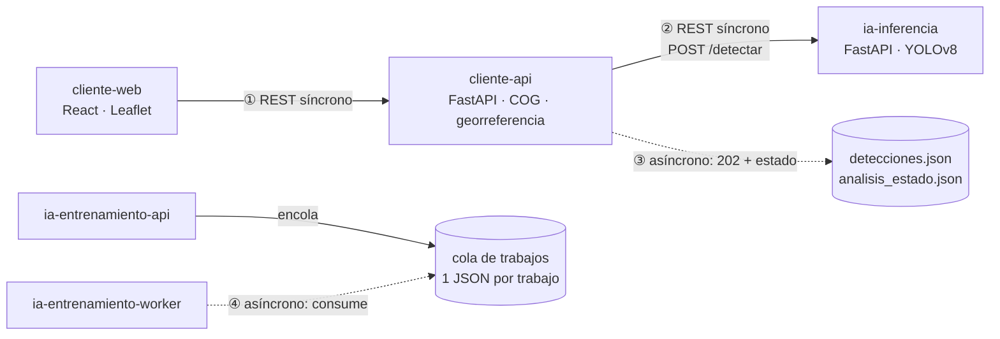
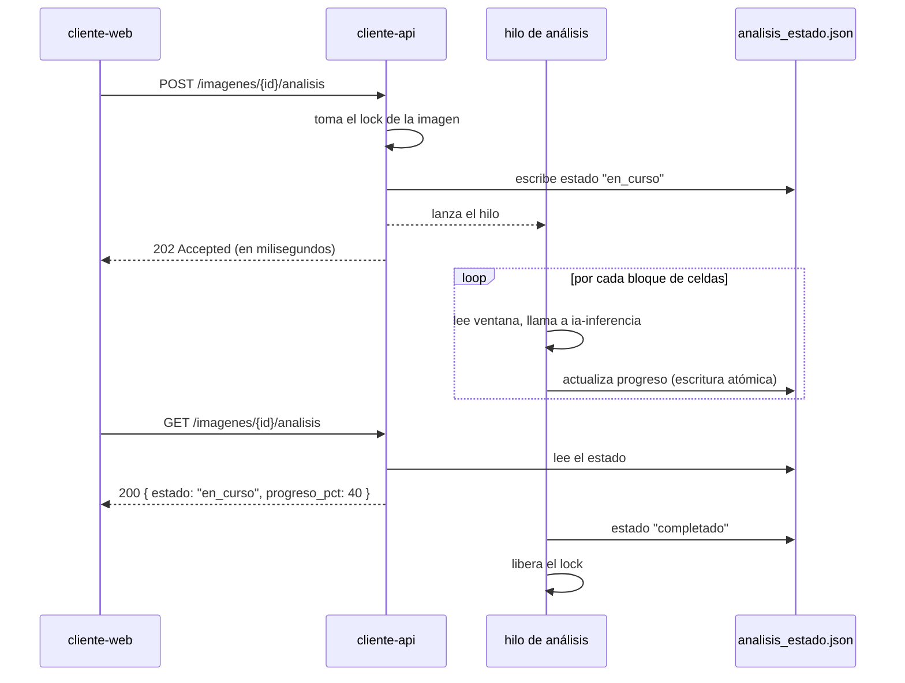
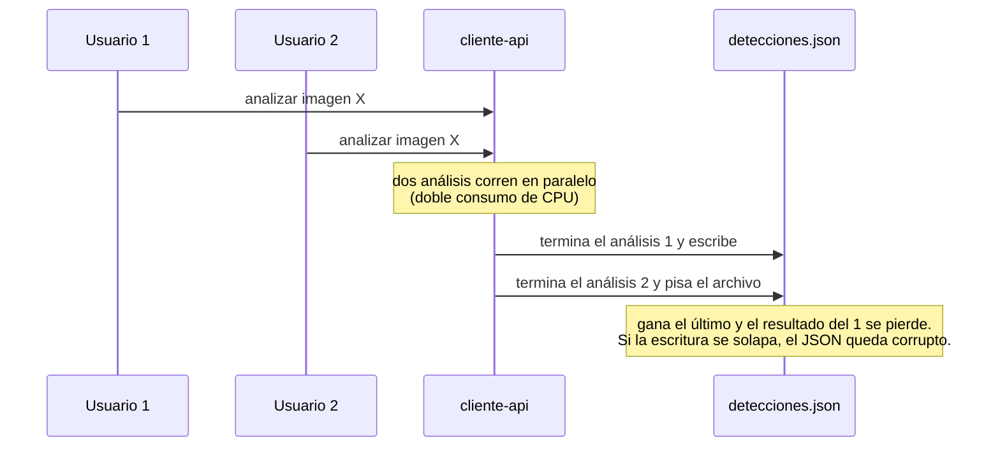
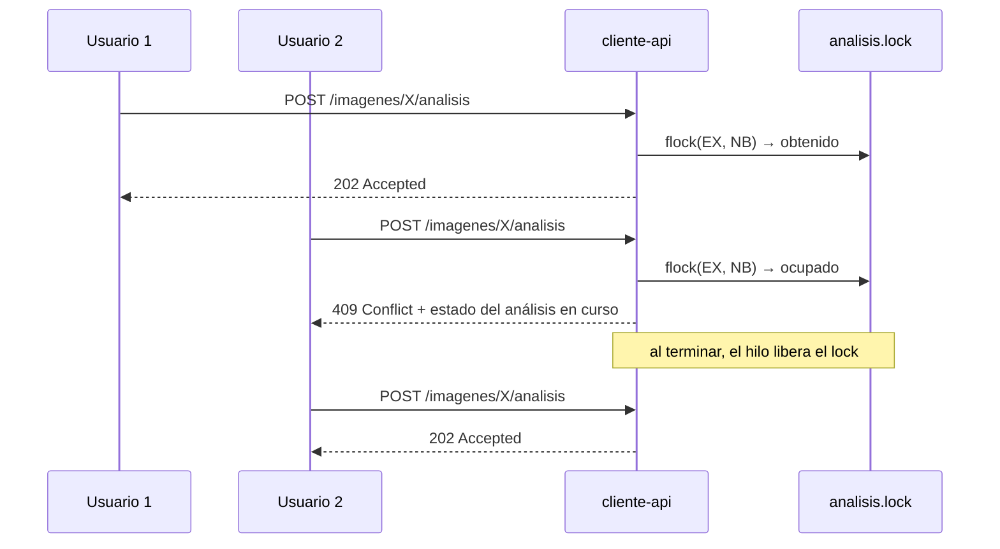

# Entrega 3 — Comunicación síncrona y asíncrona

**AgroVision — Plataforma distribuida de detección de malezas en caña de azúcar**
Programación Distribuida y Componentes · Grupo 1 · Godoy – Iriarte – Lagoria · Tag `v3-comunicacion`

## 1. Qué se entrega

El sistema ya no es el monolito de la Entrega 2: ahora son servicios separados que se hablan por red
(`project/servicios/`). Esta entrega formaliza **cómo** se hablan y resuelve un problema de
concurrencia real.



| # | Canal | Semántica | Entre quiénes |
|---|---|---|---|
| ① | REST/HTTP | Síncrono | `cliente-web` → `cliente-api` |
| ② | REST/HTTP | Síncrono | `cliente-api` → `ia-inferencia` |
| ③ | Trabajo en segundo plano con estado en disco | **Asíncrono** | `cliente-api` (petición) ⇢ `cliente-api` (hilo de análisis) ⇢ `cliente-web` (consulta) |
| ④ | Cola de trabajos en disco | **Asíncrono** | `ia-entrenamiento-api` ⇢ `ia-entrenamiento-worker` |

## 2. Canal síncrono: REST sobre HTTP

**Tramo ① — navegador a API.** Login (`POST /auth/login`), subida del GeoTIFF, listado, metadatos y
teselas XYZ del mapa. Cada llamada devuelve su respuesta en el acto y el front no puede dibujar
nada hasta tenerla.

**Tramo ② — API a servicio de IA.** `cliente-api` recorta el raster en celdas de 640 px y las
manda a `ia-inferencia`:

```
POST /detectar?conf=0.10      multipart: una parte por tesela (JPEG), con su id opaco
  ← { version_modelo, detecciones: [{ id, clase, confianza, box_local: [x1,y1,x2,y2] }] }
```

El cliente (`cliente_ia.py`) espera la respuesta de cada lote porque necesita las cajas para
traducirlas a coordenadas globales y calcular el progreso. El servicio de IA es *stateless*: no
guarda nada ni conoce coordenadas geográficas.

## 3. Canal asíncrono: trabajo en segundo plano con estado en disco

### 3.1 Análisis de un ortomosaico

Un análisis completo son del orden de miles de celdas y tarda minutos. Mantener una petición HTTP
abierta todo ese tiempo es frágil: si se corta la conexión, el cliente pierde el hilo. Por eso se
sumó un modo asíncrono (el stream SSE y el endpoint por lotes anteriores se conservan, sin cambiar
su contrato):

```
POST /imagenes/{id}/analisis?cuadrante=1&conf=0.10   → 202 { id, estado: "en_curso", progreso_pct: 0, ... }
GET  /imagenes/{id}/analisis                         → 200 { estado, progreso_pct, detecciones_acumuladas, ... }
```



Estados posibles: `en_curso`, `completado`, `fallido` y `interrumpido`. Este último se informa
cuando el archivo dice `en_curso` pero nadie tiene el lock, es decir, el proceso murió a mitad de
camino; así el estado nunca queda mintiendo.

### 3.2 Cola de entrenamientos

`ia-entrenamiento` ya usaba el mismo patrón: la API **encola** un trabajo (un JSON por trabajo con
estado `pendiente`) y el worker, en otro proceso, toma el más antiguo, lo pasa a `ejecutando`,
entrena y deja `completado` o `fallido`. API y worker no se llaman entre sí: se comunican a través
de la cola.

## 4. Qué semántica en cada punto y por qué

| Punto del sistema | Semántica | Por qué |
|---|---|---|
| Login, listado, metadatos, teselas | Síncrona | Respuesta de milisegundos que el usuario necesita para seguir. Hacerla asíncrona solo agregaría complejidad. |
| Subida del GeoTIFF | Síncrona | El usuario necesita el `id` y la validación (¿es un GeoTIFF con CRS?) antes de poder usar la imagen. |
| `cliente-api` → `ia-inferencia` | Síncrona | Cada lote es corto y su resultado es la entrada del paso siguiente. Es un pedido-respuesta típico. |
| Análisis completo de un ortomosaico | **Asíncrona** | Dura minutos. Se acepta el pedido, se responde `202` y se consulta el progreso. No ata una conexión HTTP durante todo el análisis. |
| Entrenamiento de un modelo | **Asíncrona** | Dura horas en CPU. API y worker se desacoplan por la cola, y el worker puede reiniciarse sin perder el trabajo pendiente. |

**Por qué no se usó un broker (RabbitMQ, Redis, Kafka).** Con tres desarrolladores, un solo nodo de
cada tipo y un trabajo a la vez por imagen, un broker sumaría un servicio más para operar sin
resolver nada que hoy duela. La cola en disco cumple el contrato de un mensaje asíncrono (el
productor no espera, el consumidor toma cuando puede, el estado es consultable). El límite está en
§7: con varios workers o varios nodos, el siguiente paso natural es un broker.

## 5. Caso de concurrencia P1: dos análisis simultáneos sobre la misma imagen

### 5.1 El problema (P1)

Anticipado en la Entrega 1: dos usuarios (o dos pestañas) lanzan un análisis sobre el mismo
ortomosaico a la vez. Antes de esta entrega:



Es una condición de carrera clásica: dos escritores sobre un recurso compartido sin exclusión
mutua. Además se duplica trabajo caro para obtener un resultado que se descarta.

### 5.2 La solución

Dos mecanismos complementarios, en `project/servicios/cliente-api/app/`:

1. **Exclusión mutua por imagen** (`bloqueo.py`, clase `BloqueoImagen`). Antes de analizar, la API
   toma un lock exclusivo y *no bloqueante* con `flock` sobre `analisis.lock`, dentro de la carpeta
   de la imagen. Si ya está tomado, no espera ni pisa nada: responde **`409 Conflict`** con el estado
   del análisis en curso. Se eligió `flock` porque:
   - lo gestiona el kernel, así que excluye entre hilos **y entre procesos** (varios workers de
     uvicorn);
   - si el proceso muere, el sistema operativo libera el lock solo: no hay candados huérfanos;
   - no requiere infraestructura nueva.
2. **Escritura atómica** (`escribir_json_atomico`). `detecciones.json` y `analisis_estado.json` se
   escriben a un archivo temporal en la misma carpeta, se hace `fsync` y se renombra con
   `os.replace`, que es atómico en POSIX. Un lector nunca ve un archivo a medias, aunque el
   proceso se caiga mientras escribe.

El lock se aplica en los tres modos de análisis (`analizar-stream`, `analizar` y `analisis`), de modo
que mezclarlos tampoco permite la carrera.



**Qué se descartó.** *Encolar el segundo análisis* (esperar al primero): obliga a decidir qué hacer
si los parámetros difieren (`cuadrante`, `conf`) y esconde el rechazo. *Un lock en memoria* (por
ejemplo `threading.Lock`): no funciona con más de un proceso de uvicorn. *Bloquear la fila en la
base de datos*: el estado de los análisis vive en disco junto al raster y no hay tabla de análisis.

### 5.3 Otros puntos de concurrencia revisados

| Punto | Riesgo | Tratamiento |
|---|---|---|
| Muchas teselas concurrentes al mover el mapa | Lecturas paralelas del mismo COG | Solo lecturas; no hay conflicto. No requiere lock. |
| Dos subidas simultáneas | Colisión de carpeta | Cada subida recibe un UUID propio (`crear_carpeta_nueva`); no comparten recurso. |
| Lectura de estado mientras se actualiza | Leer un JSON a medias | Resuelto por la escritura atómica. |

## 6. Cómo reproducirlo

Con el entorno levantado y un usuario creado (ver `project/servicios/base-datos/README.md`):

```bash
docker compose -f despliegue/compose.dev.yml up -d --build
USUARIO=RicLagoria CONTRASENA='...' IMAGEN=ruta/al/ortomosaico.tif \
  bash docs/pdc/entrega-3-comunicacion/probar-concurrencia.sh
```

El script ([`probar-concurrencia.sh`](probar-concurrencia.sh)) hace cinco cosas:

1. Inicia sesión y obtiene el token.
2. Sube la imagen (o usa la primera ya subida).
3. Dispara **dos** `POST /analisis` simultáneos sobre la misma imagen.
4. Espera a que termine el aceptado, consultando el estado.
5. Confirma que, con el lock libre, un pedido nuevo vuelve a aceptarse, y que `detecciones.json`
   es JSON válido y completo.

**Resultado esperado:**

| Paso | Esperado |
|---|---|
| Pedido A y pedido B simultáneos | Uno responde `202` y el otro `409` con "Ya hay un análisis en curso sobre esta imagen." |
| Consultas de estado | `en_curso` con `progreso_pct` creciente, y luego `completado` |
| Pedido tras terminar | `202` |
| `detecciones.json` | Válido; `bloques_procesados` igual a `segmentos_totales` |

## 7. Estado de verificación y límites

**Estado de verificación.** El código de la solución (`bloqueo.py`, `tareas.py`, los endpoints de
`server.py` y el cambio en `analisis.py`) está escrito y compila, y el script de prueba pasa la
verificación de sintaxis. **La demostración completa no fue ejecutada en el momento de redactar
este informe**: el resultado de §6 es el esperado por diseño, no una salida obtenida. Antes de la
defensa conviene correr el script y guardar su salida junto a este informe.

**Límites conocidos.**

- La cola de entrenamientos aún no es segura con varios workers: `obtener_siguiente_pendiente` lee
  y luego marca `ejecutando` sin exclusión, así que dos workers podrían tomar el mismo trabajo. Hoy
  hay un solo worker. Con más, hace falta el mismo lock por trabajo o un broker.
- `flock` supone un sistema de archivos local o un volumen compartido que lo soporte. En un
  volumen de red (NFS) su comportamiento depende de la configuración.
- El hilo de análisis vive en el proceso de la API: si el contenedor se reinicia, el análisis se
  corta y su estado pasa a `interrumpido`. Reanudar desde el último bloque es trabajo futuro.
- Solo Linux/macOS (`fcntl`); los contenedores del proyecto son Linux.

## 8. Cambios en el repositorio

| Archivo | Cambio |
|---|---|
| `project/servicios/cliente-api/app/bloqueo.py` | **Nuevo.** Lock por imagen y escritura atómica de JSON. |
| `project/servicios/cliente-api/app/tareas.py` | **Nuevo.** Análisis en segundo plano y estado en disco. |
| `project/servicios/cliente-api/app/server.py` | Lock en `analizar-stream` y `analizar` (409). Endpoints nuevos `POST` y `GET /imagenes/{id}/analisis`. |
| `project/servicios/cliente-api/app/analisis.py` | `detecciones.json` se escribe de forma atómica. |
| `docs/pdc/entrega-3-comunicacion/` | Certificado, informe y `probar-concurrencia.sh`. |
