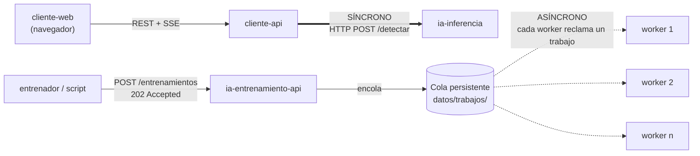
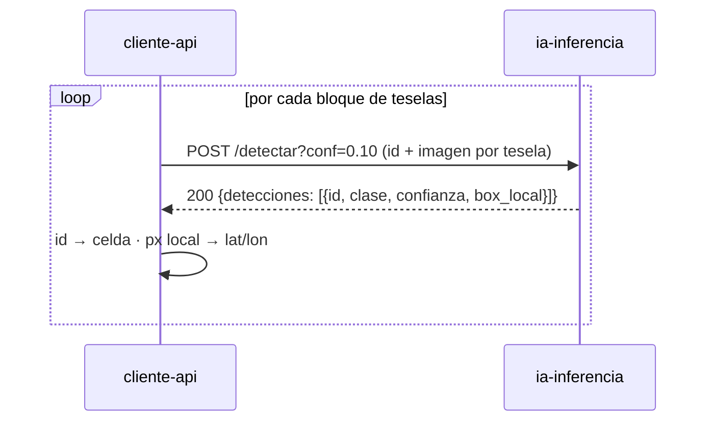
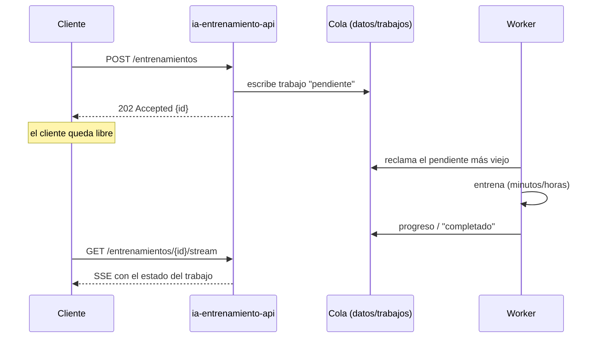

# Entrega 3 — Comunicación síncrona y asíncrona

**AgroVision — Plataforma distribuida de detección de malezas en caña de azúcar**
Programación Distribuida y Componentes · Grupo Godoy – Iriarte – Lagoria · Tag `v3-comunicacion`

## 1. Contexto

Desde la entrega anterior el sistema se reorganizó en servicios independientes (`project/servicios/`,
diseño en [`docs/arquitectura.md`](../../arquitectura.md)). Los que intervienen en esta entrega:

| Servicio | Qué hace | Contenedor |
|---|---|---|
| `cliente-api` | Ortomosaicos, teselas del mapa, análisis y georreferencia | `despliegue/compose.cliente.yml` |
| `ia-inferencia` | Recibe teselas y devuelve cajas detectadas (no sabe de geografía) | `despliegue/compose.ia.yml` |
| `ia-entrenamiento-api` | Recibe datasets y pedidos de entrenamiento | `despliegue/compose.ia.yml` |
| `ia-entrenamiento-worker` | Ejecuta los entrenamientos, uno o varios en paralelo | `despliegue/compose.ia.yml` (escalable) |

Cada punto de comunicación usa la semántica que le corresponde según cuánto tarda la operación y
si quien la pide necesita el resultado para seguir.



## 2. Canal síncrono: `cliente-api` → `ia-inferencia`

Durante un análisis, `cliente-api` recorre el ortomosaico en bloques de celdas de 640 px. Por cada
bloque arma un pedido HTTP `POST /detectar` (multipart, una parte por tesela con un `id` opaco),
**espera la respuesta** y con las cajas recibidas georreferencia las detecciones y las envía al
navegador antes de pasar al bloque siguiente.

- Código: `project/servicios/cliente-api/app/cliente_ia.py` (`ClienteIA.detectar_lote`) y
  `app/analisis.py`.
- Contrato: `contratos/ia-inferencia.openapi.yaml`.



**Por qué síncrono:**

- `cliente-api` **necesita el resultado para continuar**: sin las cajas no puede georreferenciar
  ni mandar el progreso al usuario.
- La operación es corta: segundos por bloque.
- El servicio de inferencia no guarda estado, así que un pedido-respuesta es lo más simple.
- Si un bloque falla, el error se conoce en el momento y se reintenta ese mismo bloque.
- Una cola agregaría latencia y la complejidad de correlacionar respuestas sin aportar nada.

**Funcionando** (prueba contra el contenedor `ia-inferencia`, ver
[`salida-docker-3-workers.txt`](salida-docker-3-workers.txt) para el entorno):

```
POST localhost:8001/detectar?conf=0.01  (2 teselas: c_0_0_0_0, c_0_1_640_0)
{"version_modelo":"activo","total_teselas":2,"detecciones":[
  {"id":"c_0_0_0_0","clase":"maleza","confianza":1.46,"box_local":[54.0,1.7,346.3,212.4]},
  {"id":"c_0_1_640_0","clase":"maleza","confianza":1.08,"box_local":[100.9,1.4,377.3,199.8]}]}
[HTTP 200 en 9.8 s]   ← el cliente queda esperando hasta tener la respuesta
```

## 3. Canal asíncrono: cola de entrenamientos

Entrenar un modelo YOLO tarda de minutos a horas. Cuando alguien pide un entrenamiento:

1. `ia-entrenamiento-api` guarda el pedido en una **cola persistente**: un archivo JSON por trabajo
   en el volumen compartido `datos/trabajos/`, con estado `pendiente`.
2. Responde enseguida `202 Accepted` con el id del trabajo, sin esperar a que se entrene nada.
3. Uno de los **workers**, que son contenedores separados, reclama el trabajo, lo ejecuta y va
   escribiendo el progreso en el mismo JSON.
4. Quien pidió el entrenamiento sigue el avance cuando quiere con `GET /entrenamientos/{id}/stream`
   (SSE).

- Código: `project/servicios/ia-entrenamiento/nucleo/trabajos.py` (la cola), `api/server.py`
  (productor) y `worker/entrenador.py` (consumidor).
- Contrato: `contratos/ia-entrenamiento.openapi.yaml`.



**Por qué asíncrono:**

- Ningún cliente puede quedar esperando horas con una conexión abierta.
- El productor (la API) y el consumidor (los workers) quedan **desacoplados**:
  - la API sigue atendiendo aunque no haya ningún worker libre;
  - se pueden sumar workers sin tocar la API (`docker compose ... --scale ia-entrenamiento-worker=3`);
  - si un worker se reinicia, los pedidos siguen guardados en la cola, que está en disco.

**Funcionando** con 3 workers en contenedores distintos
([`salida-docker-3-workers.txt`](salida-docker-3-workers.txt)):

```
POST /entrenamientos -> HTTP 202 en 0.047 s   (x6, todos entre 0.02 y 0.05 s)

203d3ec2c660 fallido worker=fbe44722f99f-1
f76009c6fc18 fallido worker=486d533a5dae-1
1fab47e5caf0 fallido worker=2c524e286ce9-1
a0d44438e70a fallido worker=fbe44722f99f-1
c3b7e8b79d86 fallido worker=2c524e286ce9-1
c48c3436f2c3 fallido worker=486d533a5dae-1
```

Los 6 trabajos se repartieron entre los 3 workers, dos cada uno. Terminan en `fallido` a propósito
porque en la prueba no se cargó un dataset: lo que se verifica es el recorrido por la cola, no el
entrenamiento.

## 4. Caso de concurrencia: dos workers toman el mismo entrenamiento

### El problema

El worker tomaba trabajos en **dos pasos separados**:

1. Leía la cola y buscaba el `pendiente` más viejo (`obtener_siguiente_pendiente`).
2. Recién después lo marcaba `ejecutando` (`actualizar_trabajo`).

Con un solo worker no pasa nada. Con varios, que es justamente lo que el canal asíncrono permite,
dos workers pueden leer la cola entre el paso 1 y el 2 de otro y quedarse con el mismo trabajo:

```
Worker A: lee la cola → T1 "pendiente"
Worker B: lee la cola → T1 "pendiente"      (A todavía no lo marcó)
Worker A: marca T1 "ejecutando" y entrena
Worker B: marca T1 "ejecutando" y entrena lo mismo   ← CPU duplicada, resultados pisados
```

Había además un segundo problema: el JSON de cada trabajo se reescribía en el mismo archivo. La API
(al mandar el progreso) u otro worker podían leerlo a medio escribir y fallar con `JSONDecodeError`.
En la API eso corta el stream de progreso del usuario.

### La solución

En `nucleo/trabajos.py` (commit `f95c1f7`):

| Mecanismo | Cómo funciona |
|---|---|
| **Reclamo atómico** (`reclamar_trabajo`) | El worker se queda con un trabajo creando `<id>.lock` con `os.open(..., O_CREAT \| O_EXCL)`. El sistema operativo garantiza que, si varios lo intentan a la vez, **solo uno** lo crea. Los demás reciben `FileExistsError` y pasan al siguiente pendiente. |
| **`reclamar_siguiente_pendiente`** | Reemplaza al par "leer + marcar" en el worker: recorre los pendientes del más viejo al más nuevo y devuelve el primero que logra reclamar, ya marcado `ejecutando` y con el nombre del worker. |
| **Escritura atómica** (`_escribir_json_atomico`) | El JSON se escribe en un archivo temporal y se renombra encima del original con `os.replace`, que es atómico: quien lee ve la versión anterior completa o la nueva completa, nunca una a medias. |

Es un *lock* optimista por recurso: no hay un proceso coordinador ni un lock global. Cada worker
compite solo por el trabajo que quiere tomar.

### Demostración (reproducible)

[`demo_concurrencia_cola.py`](demo_concurrencia_cola.py) usa el código real de la cola sobre una
carpeta temporal:

1. Encola 20 trabajos.
2. Lanza 5 workers en procesos separados que arrancan exactamente a la vez (barrera).
3. Cuenta cuántas veces se ejecutó cada trabajo.

No necesita Docker ni entrenar un modelo.

```bash
# desde la raíz del repo
python docs/pdc/entrega-3-comunicacion/demo_concurrencia_cola.py --modo sin-arreglo
python docs/pdc/entrega-3-comunicacion/demo_concurrencia_cola.py --modo con-arreglo
# opciones: --trabajos 50 --workers 10 --trabajo-ms 10
```

| Corrida | Ejecuciones (esperadas 20) | Trabajos repetidos | Lecturas corruptas | Salida |
|---|---|---|---|---|
| Código original de `master` | **55** | **17** (alguno hasta 5 veces) | **1** | [`salida-codigo-original.txt`](salida-codigo-original.txt) |
| Solo escritura atómica (`--modo sin-arreglo`) | 45 | 14 | 0 | [`salida-sin-arreglo.txt`](salida-sin-arreglo.txt) |
| **Con el arreglo completo** (`--modo con-arreglo`) | **20** | **0** | **0** | [`salida-con-arreglo.txt`](salida-con-arreglo.txt) |

Extracto del código original:

```
DUPLICADO  trabajo 3da4b163df8e ejecutado 5 veces por: worker-1, worker-2, worker-3, worker-4, worker-5
DUPLICADO  trabajo e5ee9a0aa3c3 ejecutado 4 veces por: worker-1, worker-3, worker-4, worker-5
ERROR      worker-2: JSONDecodeError: Expecting value: line 1 column 1 (char 0)
Ejecuciones totales: 55 (esperadas: 20)
RESULTADO: FALLA, hay trabajos repetidos, perdidos o lecturas corruptas
```

Con el arreglo:

```
Ejecuciones totales: 20 (esperadas: 20)
Trabajos ejecutados 2+ veces: 0
RESULTADO: OK, cada trabajo se ejecutó exactamente una vez
```

También se probó con carga más alta (50 trabajos, 10 workers): 50 ejecuciones y 0 repetidos.
Además, en contenedores reales con `--scale ia-entrenamiento-worker=3` (sección 3), cada trabajo
quedó asignado a un único worker.

### Límite conocido

Si un worker se cae después de reclamar un trabajo, ese trabajo queda `ejecutando` con su `.lock`
y nadie lo retoma. Detectar workers caídos y liberar sus trabajos es **recuperación ante fallos**,
que corresponde a la Entrega 5.
