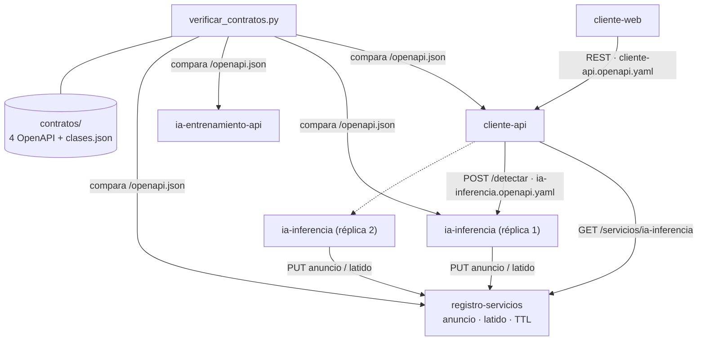
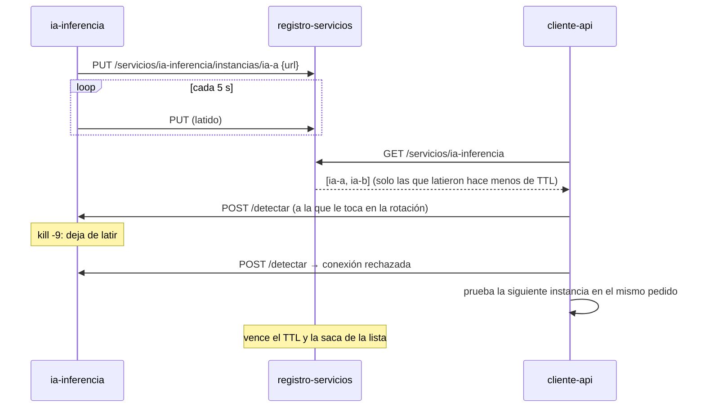

# Entrega 4 — Contratos de interfaz y descubrimiento de servicios

**AgroVision — Plataforma distribuida de detección de malezas en caña de azúcar**
Programación Distribuida y Componentes · Grupo 1 · Godoy – Iriarte – Lagoria · Tag `v4-middleware`

## 1. Qué se entrega

Los servicios de AgroVision ya corrían separados (Entregas 2 y 3). Esta entrega formaliza **cómo se
conocen y cómo se entienden**:

- **Contratos explícitos.** Cada servicio tiene un contrato OpenAPI versionado en `contratos/`.
- **Verificación automática.** Un verificador comprueba que el código cumple su contrato.
- **Descubrimiento.** Un registro de servicios reemplaza la URL fija entre `cliente-api` e
  `ia-inferencia`.



## 2. Contratos de interfaz

| Contrato | Versión | Operaciones | Proveedor | Consumidores | Origen |
|---|---|---|---|---|---|
| `ia-inferencia.openapi.yaml` | 1.1.0 | 3 | `ia-inferencia` | `cliente-api` | Escrito a mano (contrato primero) |
| `ia-entrenamiento.openapi.yaml` | 1.1.1 | 17 | `ia-entrenamiento-api` | `entrenador-web` | Escrito a mano (contrato primero) |
| `cliente-api.openapi.yaml` | 1.0.0 | 15 | `cliente-api` | `cliente-web` | Línea base generada del código el 02/11/2026 |
| `registro-servicios.openapi.yaml` | 1.0.0 | 5 | `registro-servicios` | `ia-inferencia`, `cliente-api` | Línea base generada del código el 02/11/2026 |

Además, `clases.json` fija la taxonomía de clases, cuyo orden es el índice de las etiquetas YOLO.

**Formato.** OpenAPI 3, que es el estándar de la industria para describir APIs REST. Con él se
documentan rutas, parámetros, cuerpos, respuestas y códigos de estado. Las herramientas lo leen
directamente: Swagger UI, generadores de clientes y Postman. Cada servicio sirve además su
documentación interactiva en `/docs`.

**Por qué dos orígenes.** Los contratos de IA se escribieron antes del código porque los usan
equipos distintos: quien entrena el modelo no es quien hace el mapa. Los de `cliente-api` y del
registro se generaron del código como **línea base**. Desde ese momento dejan de ser una copia: son
la referencia, y el código es el que tiene que ajustarse a ellos (ver §5).

**Ejemplo: el contrato que más desacopla.** `ia-inferencia` no sabe de geografía:

```
POST /detectar?conf=0.10     multipart: una parte por tesela (JPEG), con un id opaco
  ← { version_modelo, tarea, detecciones: [{ id, clase, confianza, box_local, contorno_local? }] }
```

El servicio de IA recibe imágenes y devuelve píxeles locales. La conversión a coordenadas la hace
`cliente-api`, que es quien tiene el raster. Gracias a esa frontera, el modelo puede cambiar sin
que el mapa se entere, y el mapa puede cambiar de proyección sin que el modelo se entere.

## 3. Evolución sin romper: versionado

La regla quedó escrita en [`contratos/README.md`](../../../contratos/README.md) y se mide desde el
punto de vista del consumidor:

| Cambio | Ejemplo | Versión |
|---|---|---|
| Agrega algo opcional; un consumidor viejo sigue andando | Campo nuevo en una respuesta, ruta nueva, parámetro opcional | **Menor** (1.0.0 → 1.1.0) |
| Rompe a un consumidor existente | Quitar o renombrar una ruta, un campo o un parámetro | **Mayor** (1.1.0 → 2.0.0) |
| Solo documentación | Describir una ruta que ya existía | **Parche** (1.1.0 → 1.1.1) |

El servicio declara la misma versión que su contrato (`FastAPI(version=...)`), y el verificador la
controla.

**Caso real: se cambió el motor de IA sin romper a nadie.** Entre octubre y noviembre,
`ia-inferencia` pasó de un modelo de **detección** a uno de **segmentación de instancias**, con
entrenamiento en GPU y análisis a varias escalas. Fue un cambio interno grande. Su contrato pasó de
1.0.0 a 1.1.0 y solo **agregó** dos cosas:

- el campo `tarea` (`detect` o `segment`);
- el campo opcional `contorno_local` en cada detección.

Un `cliente-api` que no conoce esos campos los ignora y sigue recibiendo `box_local`, como antes.
Ninguna ruta, parámetro ni campo existente cambió.

**Caso real: un cambio de parche.** Al verificar apareció que `ia-entrenamiento` expone `GET /salud`
pero su contrato no la documentaba (§5). Documentarla no cambia el comportamiento, así que la
versión pasó de 1.1.0 a 1.1.1.

## 4. Descubrimiento de servicios

### 4.1 El problema

Hasta esta entrega, `cliente-api` encontraba a `ia-inferencia` por una URL fija en una variable de
entorno (`IA_INFERENCIA_URL`). Eso trae tres problemas:

- con dos réplicas no hay forma de usarlas a las dos;
- si esa instancia cae, el análisis falla;
- si cambia de máquina, hay que reconfigurar y reiniciar al consumidor.

### 4.2 Diseño: registro con anuncio, latido y vencimiento

Se implementó un registro propio, `project/servicios/registro-servicios`, de unas 100 líneas en
FastAPI. Su contrato es [`registro-servicios.openapi.yaml`](../../../contratos/registro-servicios.openapi.yaml):

| Operación | Quién la usa | Qué hace |
|---|---|---|
| `PUT /servicios/{nombre}/instancias/{id}` | El proveedor | Alta y latido. Es idempotente: la primera llamada registra la instancia y las siguientes renuevan su vencimiento. |
| `DELETE /servicios/{nombre}/instancias/{id}` | El proveedor | Baja ordenada al apagarse. |
| `GET /servicios/{nombre}` | El consumidor | Devuelve las instancias vivas, es decir, las que latieron en los últimos `REGISTRO_TTL_S` segundos. |
| `GET /servicios` y `GET /salud` | Operación | Listado general y sonda de vida. |

**Del lado del proveedor** (`ia-inferencia/app/anuncio.py`):

- al arrancar se anuncia con su URL y repite el anuncio cada 5 s;
- al apagarse se da de baja;
- si muere sin avisar, el TTL lo saca del registro;
- con `docker compose --scale`, cada réplica anuncia su propia IP sin configuración por réplica.

**Del lado del consumidor** (`cliente-api/app/descubrimiento.py` y `cliente_ia.py`), `ClienteIA` ya
no conoce ninguna URL de inferencia, solo el nombre lógico `ia-inferencia`:

1. Pregunta al registro, con una caché de 2 s, cuáles son las instancias vivas.
2. Reparte los pedidos entre ellas por turnos (*round robin*).
3. Si una no responde (conexión rechazada o *timeout*), prueba la siguiente en el mismo pedido.
   Esto es seguro porque `/detectar` no tiene estado: repetirlo no tiene efectos.
4. Si el registro no responde o no hay nadie anunciado, usa `IA_INFERENCIA_URL` como respaldo.
   Así el registro **no es un punto único de falla**: en el peor caso el sistema vuelve a la
   configuración estática que tenía antes.



**Por qué un registro propio y no Consul o el DNS de Docker.** El DNS de Docker solo resuelve
nombres dentro de una misma red de compose, y AgroVision está pensado para desplegar el plano IA y el
plano Cliente en máquinas distintas. Además, el DNS no informa si una instancia está viva. Consul
resuelve todo eso, pero suma un componente con su propio protocolo y su propia operación para un
caso de un solo servicio descubierto. El registro propio implementa el mismo patrón que Consul
(*self-registration* con *heartbeat* y TTL) en un servicio que el grupo entiende de punta a punta. Si
el sistema crece, el contrato del lado consumidor (`descubrimiento.instancias(nombre)`) permite
cambiar el registro por Consul sin tocar el resto.

### 4.3 Demostración ejecutada

[`demo_descubrimiento.py`](demo_descubrimiento.py) levanta procesos reales: el registro, con TTL de
6 s para la demo, y varias instancias del mismo `server.py` de `ia-inferencia` con el modelo
versionado. Les habla con el `ClienteIA` real de `cliente-api`. Salida completa en
[`salida-descubrimiento.txt`](salida-descubrimiento.txt); extracto:

```
== 1) Alta automática: nadie las cargó a mano, se anunciaron solas
   ia-a (http://127.0.0.1:8101, vence en 4.13 s)
   ia-b (http://127.0.0.1:8102, vence en 5.31 s)
== 2) Reparto: el cliente solo sabe el nombre 'ia-inferencia'
   GET /modelo -> http://127.0.0.1:8101 (modelo v1) | POST /detectar -> http://127.0.0.1:8102 (0 detecciones)
== 3) Caída abrupta: kill -9 a A (no llega a darse de baja)
[AVISO] ia-inferencia en http://127.0.0.1:8101 no responde ([Errno 111] Connection refused); pruebo otra instancia.
   GET /modelo -> http://127.0.0.1:8102 (modelo v1) | POST /detectar -> http://127.0.0.1:8102 (0 detecciones)
== 4) Vencimiento: espero 7 s sin latidos de A
   ia-b (http://127.0.0.1:8102, vence en 4.85 s)
== 5) Instancia nueva C (aparece sola) y apagado ordenado de B (se retira al instante)
   con B apagada con SIGTERM:
   ia-c (http://127.0.0.1:8199, vence en 4.89 s)
== 6) Registro caído: el cliente vuelve a IA_INFERENCIA_URL (que hoy es C) y sigue
[DESCUBRIMIENTO] Registro no disponible ([Errno 111] Connection refused); uso la URL fija.
   GET /modelo -> http://127.0.0.1:8199 (modelo v1) | POST /detectar -> http://127.0.0.1:8199 (0 detecciones)
FIN: el consumidor nunca tuvo configurada la URL de A ni de B.
```

Las "0 detecciones" son esperables: la tesela de prueba es una imagen lisa generada por el script.
Lo que se demuestra es **quién** atiende cada pedido, no el resultado del modelo. En el paso 2 la
rotación avanza en cada llamada, así que `/modelo` y `/detectar` caen alternadamente en A y en B.

## 5. Verificación del desacople

Un contrato que nadie controla termina siendo un acuerdo informal más. Por eso se escribió
[`contratos/verificar_contratos.py`](../../../contratos/verificar_contratos.py), que compara cada
servicio **en marcha** (su `/openapi.json`, que FastAPI genera a partir del código real) contra su
contrato. Falla con código de salida 1 si:

- la versión del código no es la del contrato;
- el contrato promete una ruta o método que el servicio no tiene, o al revés;
- un parámetro falta, sobra o cambia de obligatorio a opcional (o viceversa);
- el código de éxito (2xx) difiere.

Las descripciones y ejemplos no se comparan: el objetivo es atrapar lo que rompe a un consumidor.

**Resultado real.** La primera ejecución, con los cuatro servicios levantados, **encontró una
diferencia que nadie había notado** ([`salida-verificacion-inicial.txt`](salida-verificacion-inicial.txt)):

```
✗ ia-entrenamiento (http://127.0.0.1:8202) contra ia-entrenamiento.openapi.yaml: 1 diferencia(s)
    - GET /salud: el servicio la expone pero el contrato no la documenta
```

Se documentó `/salud` (versión 1.1.1) y la verificación pasó
([`salida-contratos.txt`](salida-contratos.txt)):

```
✓ registro-servicios cumple registro-servicios.openapi.yaml: 5 operaciones, versión y parámetros
✓ ia-inferencia cumple ia-inferencia.openapi.yaml: 3 operaciones, versión y parámetros
✓ ia-entrenamiento cumple ia-entrenamiento.openapi.yaml: 17 operaciones, versión y parámetros
✓ cliente-api cumple cliente-api.openapi.yaml: 15 operaciones, versión y parámetros
CONTRATOS OK
```

**Prueba en sentido contrario.** [`demo_contratos.py`](demo_contratos.py) simula tres cambios hechos
"sin avisar" sobre una copia de los contratos, y el verificador los señala uno por uno:

```
✗ registro-servicios ... - versión: contrato 2.0.0 ≠ código 1.0.0
✗ ia-inferencia ...      - POST /detectar: el parámetro query:confianza del contrato no existe en el servicio
                         - POST /detectar: parámetro opcional query:conf sin documentar
✗ cliente-api ...        - POST /imagenes/{imagen_id}/borrar: está en el contrato pero el servicio no la tiene
RESULTADO: contratos reales -> 0 (0 = cumplen); contratos alterados -> 1 (1 = el verificador detectó la ruptura)
```

**Qué cambia en la forma de trabajar.** La regla escrita en `contratos/README.md` es correr el
verificador antes de abrir un PR que toque un `server.py`. Si falla, hay dos salidas: arreglar el
código, o actualizar el contrato **y** su versión según la tabla de §3. Lo que antes dependía de
que cada integrante "se acordara" ahora lo controla una herramienta.

## 6. Cómo reproducirlo

Sin Docker, desde la raíz del repo, con las dependencias de `cliente-api`, `ia-inferencia` e
`ia-entrenamiento` instaladas en un mismo entorno de Python:

```bash
python docs/pdc/entrega-4-middleware/demo_contratos.py       # verificación + rupturas simuladas
python docs/pdc/entrega-4-middleware/demo_descubrimiento.py  # los seis escenarios de §4.3
```

Con Docker, el registro ya está en `despliegue/compose.dev.yml`, en `compose.ia.yml` y, como
opcional, en `compose.cliente.yml`:

```bash
docker compose -f despliegue/compose.dev.yml up -d --build
curl localhost:8003/servicios/ia-inferencia          # la instancia anunciada
python contratos/verificar_contratos.py ia-inferencia=http://localhost:8001 \
  cliente-api=http://localhost:8000 registro-servicios=http://localhost:8003
```

## 7. Límites conocidos

- **Lo que se ejecutó y lo que no.** Las dos demostraciones se ejecutaron con procesos reales el
  02/11/2026, y sus salidas están en esta carpeta. El arranque con Docker Compose **no** se ejecutó:
  el entorno donde se generó la evidencia no tenía daemon de Docker. Los archivos de compose se
  validaron como YAML.
- **Registro en memoria y de una sola instancia.** Si se reinicia, las instancias vuelven a
  anunciarse en el siguiente latido (5 s), y mientras tanto los consumidores usan la URL de
  respaldo. Para alta disponibilidad del propio registro habría que replicarlo, que es lo que
  resuelven Consul o etcd.
- **Sin autenticación.** Cualquiera que llegue al puerto 8003 puede anunciar una instancia. Se
  tratará en la Entrega 5 (seguridad) con un token compartido entre planos.
- **Planos en máquinas distintas.** La IP interna del contenedor no le sirve a otra máquina. En ese
  caso hay que definir `URL_ANUNCIADA` con la dirección pública (documentado en `compose.ia.yml`).
- **Solo `ia-inferencia` se anuncia.** Es el único servicio que otro servicio llama.
  `entrenador-web` llega a `ia-entrenamiento-api` por su propio nginx.
- **Alcance del verificador.** Compara la superficie de la API (rutas, métodos, parámetros, versión
  y código de éxito), no el detalle de cada esquema JSON.

## 8. Cambios en el repositorio

| Archivo | Cambio |
|---|---|
| `project/servicios/registro-servicios/` | **Nuevo.** Servicio de registro con anuncio, latido y TTL, con su Dockerfile. |
| `project/servicios/ia-inferencia/app/anuncio.py` | **Nuevo.** Anuncio automático al arrancar, latido y baja al apagarse. |
| `project/servicios/ia-inferencia/app/server.py` | Ciclo de vida que activa el anuncio; versión 1.1.0, alineada con el contrato. |
| `project/servicios/cliente-api/app/descubrimiento.py` | **Nuevo.** Consulta al registro con caché, rotación y respaldo. |
| `project/servicios/cliente-api/app/cliente_ia.py` | Usa el descubrimiento y pasa a otra instancia ante fallas de transporte. |
| `project/servicios/ia-entrenamiento/api/server.py` | Versión 1.1.1, alineada con el contrato. |
| `contratos/cliente-api.openapi.yaml`, `contratos/registro-servicios.openapi.yaml` | **Nuevos.** Contratos de línea base. |
| `contratos/ia-entrenamiento.openapi.yaml` | Se documenta `GET /salud` (1.1.1). |
| `contratos/verificar_contratos.py`, `contratos/README.md` | **Nuevo** verificador, más la regla de versionado y su uso. |
| `despliegue/compose.{dev,ia,cliente}.yml` | Se suma `registro-servicios` y `REGISTRO_URL`. |
| `docs/pdc/entrega-4-middleware/` | Certificado, informe, dos demos y sus salidas. |
