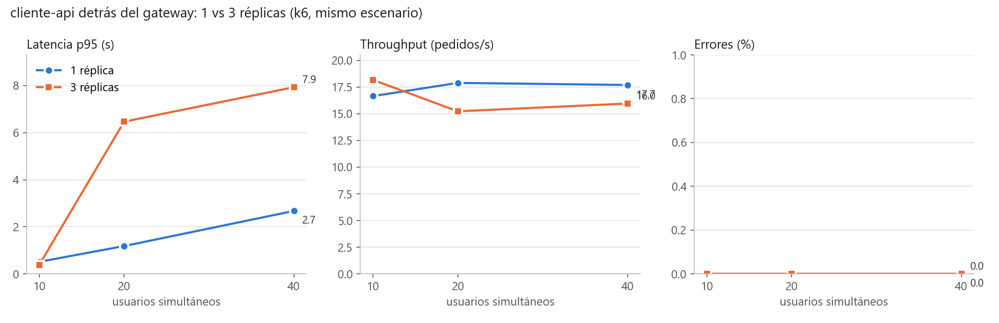
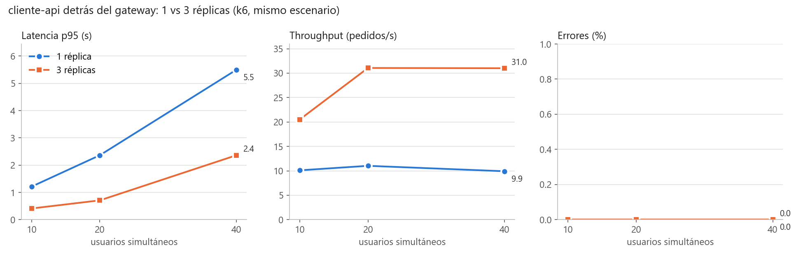

# Entrega 6 — Patrones de diseño y escalabilidad

**Módulo 6.** Qué pide la entrega:
- dos patrones aplicados y justificados;
- una prueba de escalado horizontal (1 contra 3 instancias detrás de un balanceador);
- un test de carga documentado: latencia p95, throughput y errores.

| Campo | Valor |
|---|---|
| **Grupo N°** | 1 (Godoy – Iriarte – Lagoria) |
| **Tag / Release** | `v6-patrones` |
| **Rama** | `pdc/final` |

## Checklist

| Requisito | Cumple | Evidencia |
|---|---|---|
| Dos patrones aplicados, con componente y motivo | **Sí** | §1: API Gateway (proxy y fachada) y mensaje-comando con cola |
| Prueba de escalado horizontal: 1 contra 3 instancias detrás de un balanceador | **Sí** | §2: `cliente-api` × 1 y × 3 detrás del gateway nginx, con el reparto medido |
| Test de carga con p95, throughput y errores, antes y después | **Sí** | §3: k6 con 10, 20 y 40 usuarios, tres series, gráficos y JSON crudos; se encontró y corrigió el cuello de botella (la base) |
| Prueba de resiliencia: falla parcial con tráfico | **Sí** | §4: se cae una réplica en medio del tráfico |

## 1. Patrones aplicados

### 1.a API Gateway (proxy y fachada) — `gateway` (nginx)

| | |
|---|---|
| **Problema** | El sistema tiene ocho servicios. Sin una puerta única, cada uno publica su puerto y tiene que resolver por su cuenta TLS, límites y CORS. Además, no hay forma de repartir carga entre copias. |
| **Solución** | [`despliegue/nginx/gateway.conf`](../../../despliegue/nginx/gateway.conf): un nginx es la única entrada (443). `/` va a `cliente-web` y `/api/` al grupo de réplicas de `cliente-api`. |
| **Rol de proxy** | En `/api/` reenvía el pedido con la misma interfaz y agrega TLS, cabeceras de seguridad, el límite del login, balanceo round-robin y reintento en otra réplica si una falla. |
| **Rol de fachada** | Para el navegador hay una sola dirección (`https://localhost`) que esconde la web, la API, la base, la IA y el registro. |
| **Consecuencias** | A favor: la seguridad y el balanceo viven en un solo lugar, y los servicios de atrás no publican puertos. En contra: es un punto único de falla (habría que replicarlo con una IP flotante), y si cambia la cantidad de réplicas hay que recargarlo. |

### 1.b Mensaje-comando con cola — `ia-entrenamiento`

| | |
|---|---|
| **Problema** | Entrenar un modelo tarda horas y la GPU es una sola. Una llamada síncrona dejaría al usuario esperando y se cortaría por timeout. |
| **Solución** | `POST /entrenamientos` deja el comando «entrenar con estos datos» en una cola en disco y responde `202` al instante. Un worker, en un contenedor aparte, toma los comandos de a uno. |
| **Por qué comando y no evento** | Es una orden con un único destinatario, el worker, y quien la manda espera que se ejecute. No es un hecho que varios interesados puedan escuchar. |
| **Consecuencias** | A favor: si el worker se cae, el comando sigue en la cola; se pueden sumar workers sin tocar la API (Entrega 3: el reclamo atómico evita que dos workers tomen el mismo). En contra: no hay respuesta inmediata, y el front tiene que consultar el estado del trabajo. |

## 2. Escalado horizontal

`cliente-api` se puede multiplicar porque no guarda estado propio:
- la sesión viaja en el JWT;
- los datos están en PostGIS;
- los archivos están en un volumen compartido.

`escalar.sh` cambia la cantidad de réplicas y reinicia el gateway para que tome las IPs nuevas:

```bash
bash despliegue/pdc/escalar.sh 3      # docker compose up --scale cliente-api=3 + reinicio del gateway
```

El reparto del balanceador se mide con el log del gateway (`replica=<ip>` en cada pedido); queda en `carga/*/reparto-*.txt`.

## 3. Test de carga

**Escenario** ([`carga/prueba-carga.js`](carga/prueba-carga.js)): usuarios que miran el mapa de un ortomosaico.

- El **85 %** de los pedidos son teselas PNG, que es lo más pesado del uso normal: leer el COG y armar la imagen.
- El **15 %** restante son el listado de imágenes y las estadísticas.
- Cada usuario espera 0,2 s entre pedidos.
- Se piden solo teselas interiores: las del borde dan `404` siempre, con carga o sin ella, y ensuciarían la tasa de errores.

La carga sube en rampa durante 15 s y se mantiene estable, primero con 1 réplica y después con 3, siempre detrás del gateway. Se hicieron tres series completas; todas quedan en `carga/` con los JSON crudos de k6.

### Serie 2: sin pool de conexiones (90 s por nivel)



| Usuarios | Réplicas | p95 (s) | Mediana (s) | Throughput (ped/s) | Errores |
|---|---|---|---|---|---|
| 10 | 1 | 0,52 | 0,34 | 16,6 | 0 % |
| 10 | 3 | 0,38 | 0,24 | 18,2 | 0 % |
| 20 | 1 | 1,18 | 0,85 | 17,9 | 0 % |
| 20 | 3 | 6,47 | 0,41 | 15,2 | 0 % |
| 40 | 1 | 2,67 | 1,98 | 17,7 | 0 % |
| 40 | 3 | 7,93 | 0,99 | 16,0 | 0 % |

**Qué mostró:** con 3 réplicas la mediana baja a la mitad, pero desde 20 usuarios el p95 empeora y el throughput no sube. La serie 1 (45 s por nivel, en [`carga/corrida-1`](carga/corrida-1/)) dio lo mismo, así que no es ruido.

**Diagnóstico:** se midió el uso de CPU durante la carga.
- Las 3 réplicas sumaban cerca del 480 %.
- La base llegaba al **90–99 %**: `cliente-api` abría una conexión nueva a PostgreSQL en cada pedido, y PostgreSQL crea un proceso por conexión.

Con más réplicas había más conexiones contra **una sola base**: el cuello de botella estaba en otra capa. Es el caso que plantea el módulo: «escalar horizontalmente solo ayuda si se escala la capa que limita al sistema».

**Arreglo:** un pool de conexiones en `cliente-api` (`psycopg_pool`, en [`auth.py`](../../../project/servicios/cliente-api/app/auth.py)). Cada réplica reusa hasta 10 conexiones abiertas. Ninguna consulta cambió, porque todas ya usaban `with conexion() as con:`.

### Serie 3: con pool de conexiones (90 s por nivel)



| Usuarios | Réplicas | p95 (s) | Mediana (s) | Throughput (ped/s) | Errores |
|---|---|---|---|---|---|
| 10 | 1 | 1,21 | 0,70 | 10,1 | 0 % |
| 10 | 3 | **0,41** | 0,23 | **20,5** | 0 % |
| 20 | 1 | 2,36 | 1,44 | 11,0 | 0 % |
| 20 | 3 | **0,71** | 0,38 | **31,1** | 0 % |
| 40 | 1 | 5,50 | 3,48 | 9,9 | 0 % |
| 40 | 3 | **2,36** | 0,76 | **31,0** | 0 % |

**Conclusiones:**

- **Con el pool, 3 réplicas escalan.** Con 20 y 40 usuarios atienden unas **3 veces más pedidos por segundo** que 1 réplica (≈ 31 contra ≈ 10), y el p95 baja de 5,5 a 2,4 s con 40 usuarios.
- **Mejora en valores absolutos.** Con 3 réplicas y 40 usuarios se pasó de 16 ped/s y p95 de 7,9 s (sin pool) a **31 ped/s y p95 de 2,4 s** (con pool).
- **Errores: 0 %** en todas las corridas de las tres series.
- **Reparto parejo.** El balanceo round-robin repartió casi exacto entre las 3 réplicas: 1148, 1145 y 1147 pedidos con 40 usuarios ([`reparto-3rep-40vus.txt`](carga/corrida-3-pool/reparto-3rep-40vus.txt)).
- **Lo que no cierra del todo.** La línea base de 1 réplica salió más baja en la serie 3 que en la 2 (≈ 10 contra ≈ 17 ped/s), en la misma máquina.
  - Un pool de 40 conexiones dio lo mismo que uno de 10, así que el tamaño del pool no es la causa.
  - Repetir la base sin pool quedó invalidado: la notebook se suspendió en medio de la medición.
  - Por eso la mejora se informa también en valores absolutos (el punto anterior), que no dependen de esa base.
- **Límites del entorno.** Todo corre en una notebook: las réplicas, la base, el gateway y el propio k6 comparten 8 núcleos y el mismo disco. En servidores separados la mejora sería mayor, pero no lo medimos.

## 4. Resiliencia: se cae una réplica con tráfico

[`despliegue/pdc/probar-failover.sh`](../../../despliegue/pdc/probar-failover.sh) levanta 3 réplicas y manda 60 pedidos seguidos. En el pedido 21 **mata de golpe** una réplica con `docker kill`.

Resultado ([`salida-failover.txt`](salida-failover.txt)):

- **60 de 60 pedidos OK, 0 con error.**
- **8 pedidos** llegaron primero a la réplica caída. El gateway no pudo conectar (`proxy_connect_timeout 2s`) y los reintentó en otra (`proxy_next_upstream`). En la cabecera `X-Atendido-Por` aparecen como `a,b`: probó `a` y atendió `b`.
- Después de la caída, el tráfico quedó repartido entre las dos réplicas vivas.

Esto combina tres mecanismos:
- **réplicas**, porque la API no guarda estado;
- **balanceo con reintento** en el gateway;
- **healthchecks** de Docker, que vuelve a levantar lo que se cae.

## Cómo reproducir

```bash
bash despliegue/pdc/generar-certificado.sh
docker compose -f despliegue/compose.dev.yml -f despliegue/compose.pdc.yml up -d --build
bash despliegue/pdc/medir-escalado.sh "10 20 40" corrida-nueva
python docs/pdc/entrega-6-patrones/carga/graficar.py docs/pdc/entrega-6-patrones/carga/corrida-nueva
bash despliegue/pdc/probar-failover.sh
```

---

### Espacio para el docente

| Nota | Corregido por | Fecha de corrección |
|---|---|---|
| ____ / 10 | | __ /__ / ____ |
